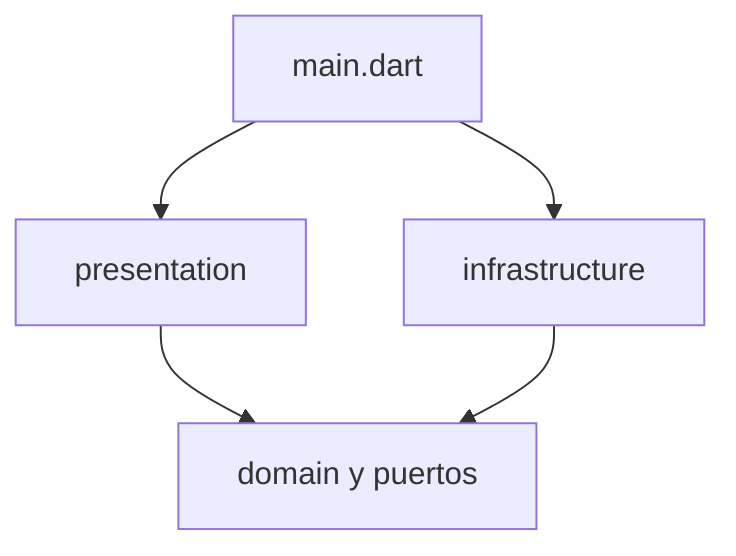

# Arquitectura

Prep_Up es un **monolito modular con puertos hexagonales**.

No es un conjunto de microservicios. No hay procesos propios que desplegar por dominio: la app es un cliente, Supabase ya es el backend de auth y datos, y Gemini ya es el servicio de IA. Partir el cliente en servicios añadiría red y contratos sin un equipo ni un despliegue que lo justifique.

Tampoco es Clean Architecture de libro. No hay un caso de uso por pantalla ni DTOs duplicados. Las clases grandes (`GeminiService`, `InterviewVoiceController`, `SimulatedCallScreen`, `DashboardScreen`) se movieron de carpeta y, donde hacía falta, implementan un puerto. Su cuerpo no se partió.

## Regla de dependencia



- `presentation` importa puertos y entidades. No importa `shared/infrastructure` ni `features/*/infrastructure`.
- `domain` declara contratos y modelos. No construye Supabase, SQLite ni HTTP.
- `infrastructure` implementa los puertos.
- Solo `lib/main.dart` instancia los adapters y los registra en `Provider`.

Excepción consciente: `AuthGateway` expone tipos de `supabase_flutter` (`AuthResponse`, `User`, `AuthState`). Este corte no introdujo DTOs de auth. El día que se cambie el proveedor de identidad, ese puerto hay que estrecharlo.

## Dónde vive cada cosa

```
lib/
├── main.dart                         # composition root
├── core/                             # rutas, errores de UI, idioma, config
├── shared/
│   ├── domain/entities/              # modelos que cruzan módulos
│   ├── domain/ports/                 # RelationalDatabaseService, OfflineCache
│   ├── infrastructure/               # Supabase, SQLite, CachedDatabaseService
│   └── presentation/widgets/         # botones, tarjetas, scaffold, logo
├── features/
│   ├── auth/                         # domain + infrastructure + presentation
│   ├── interview/                    # domain + infrastructure + presentation
│   ├── analysis/                     # solo presentation
│   ├── tracking/                     # solo presentation
│   ├── profile/                      # solo presentation
│   ├── settings/                     # solo presentation
│   └── dashboard/                    # solo presentation
├── l10n/                             # ARB y AppLocalizations generado
└── theme/                            # ThemeData y AppThemeController
```

`analysis`, `tracking`, `profile`, `settings` y `dashboard` no tienen infraestructura propia. Leen los puertos compartidos.

## Composition root

`main` hace, en este orden:

1. Carga `.env`.
2. Lee `SessionPreferences` para decidir si Supabase persiste la sesión.
3. Inicializa Supabase con `SUPABASE_URL` y `SUPABASE_ANON_KEY`.
4. Crea `SupabaseDatabaseService` y `SqfliteDatabaseService`.
5. Los envuelve en `CachedDatabaseService` y llama `initialize()`.
6. Crea `AuthService` con la base **remota**, no con la caché.
7. Arranca `AiInterviewTrainerApp` y registra en `Provider`:
   - `AuthGateway`
   - `SessionPreferences`
   - `RelationalDatabaseService` (la caché)
   - `InterviewAiPort` (`GeminiService`)
   - `InterviewConfigController`
   - `MediaDeviceController`

`AppThemeController` queda fuera del `MultiProvider`. Recibe por constructor el mismo `AuthGateway` y la misma base remota. El tema no pasa por SQLite.

## Puertos

| Puerto | Lo implementa | Lo consume |
| --- | --- | --- |
| `RelationalDatabaseService` | `SupabaseDatabaseService`, `SqfliteDatabaseService`, `CachedDatabaseService` | dashboard, perfil, ajustes, historial, procesamiento, tema |
| `OfflineCache` | `CachedDatabaseService` | dashboard, perfil, historial, para pintar primero lo local |
| `AuthGateway` | `AuthService` | pantallas de auth, dashboard, perfil, ajustes, procesamiento, tema |
| `SessionPreferences` | `AuthPreferences` | login y el arranque |
| `InterviewAiPort` | `GeminiService` | `InterviewVoiceController`, `InterviewSessionController`, procesamiento, llamada simulada |

## Qué no hace esta arquitectura

- No parte `GeminiService` ni el controlador de voz.
- No mueve `GEMINI_API_KEY` a una Edge Function. La clave sigue en el cliente, leída de `.env`.
- No hace que el alta de usuario ni el tema pasen por `CachedDatabaseService`. Eso cambiaría qué queda disponible sin red.
- No borra código que hoy no usa la UI: `InterviewSessionController`, `AiInterviewService`, `GeminiAiInterviewService`, `VideoAnalysisService`, `VideoStorageService`. Están en el módulo de entrevista para no perder el contrato.

## Cómo saber si un cambio respeta la frontera

Un import de `shared/infrastructure` o de `features/*/infrastructure` fuera de `lib/main.dart` y de la propia carpeta `infrastructure` rompe la regla. Las pantallas piden el puerto con `context.read<AuthGateway>()` o `context.read<InterviewAiPort>()`. No hacen `AuthService()` ni `GeminiService()`.
