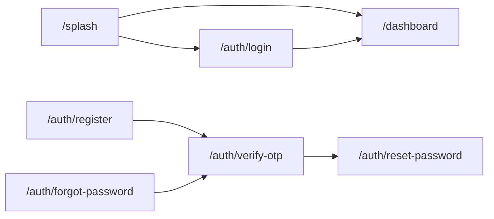
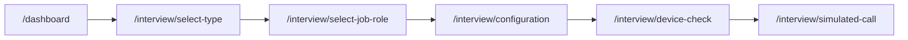
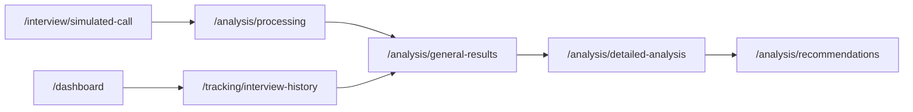

# Flujos

## Arranque

`/splash` mira `AuthGateway.currentUser`. Si hay sesión, reemplaza la ruta por `/dashboard`. Si no, muestra la entrada a login y registro.

`/login-callback` es el retorno de Supabase y abre el login marcado como verificado.

## Armar una entrevista

`InterviewConfigController` conserva tipo, rol y duración entre esas pantallas. El chequeo de dispositivos usa `MediaDeviceController` (cámara, micrófono, permisos).

## Llamada

En `/interview/simulated-call` la pantalla crea `InterviewVoiceController` con el `InterviewAiPort` del árbol.

1. La IA genera la pregunta de apertura (`generateOpeningQuestion`).
2. TTS la lee.
3. STT transcribe la respuesta.
4. El controlador evalúa (`evaluateUserAnswer`), pide feedback (`generateFeedback`) y la siguiente pregunta (`generateConversationalNextQuestion`).
5. Al cerrar, pide el mensaje de cierre (`generateClosingMessage`).

Si Groq no devuelve el formato esperado, el adapter degrada la respuesta en lugar de cortar la llamada. Los fallos que sí salen hacia la UI viajan como `AiProviderException` y `userFriendlyErrorMessage` los convierte en texto.

Al terminar, la pantalla navega a procesamiento con `config` y `session`.

## Análisis y seguimiento

Procesamiento llama `analyzeInterviewSession` y `generateInterviewResults`, guarda la sesión y el resultado con `RelationalDatabaseService`, y abre el resumen.

El historial abre el mismo resumen cuando ya existe un resultado para esa sesión.

## Rutas

Definidas en `lib/core/navigation/app_routes.dart` y construidas en `AppRouter`.

| Ruta | Pantalla |
| --- | --- |
| `/splash` | splash |
| `/auth/login` | login |
| `/auth/register` | registro |
| `/auth/forgot-password` | recuperar |
| `/auth/verify-otp` | OTP de alta o de recuperación |
| `/auth/reset-password` | nueva contraseña |
| `/dashboard` | inicio |
| `/profile` | perfil |
| `/settings` | ajustes |
| `/interview/select-type` | tipo |
| `/interview/select-job-role` | rol |
| `/interview/configuration` | duración y opciones |
| `/interview/device-check` | cámara y micrófono |
| `/interview/simulated-call` | simulación |
| `/analysis/processing` | generación del informe |
| `/analysis/general-results` | resumen |
| `/analysis/detailed-analysis` | detalle |
| `/analysis/recommendations` | recomendaciones |
| `/tracking/interview-history` | historial |

Los argumentos de ruta son `InterviewConfig`, `InterviewSession`, `InterviewResultsModel`, o un `Map` con las claves `config`, `session` y `results`.
