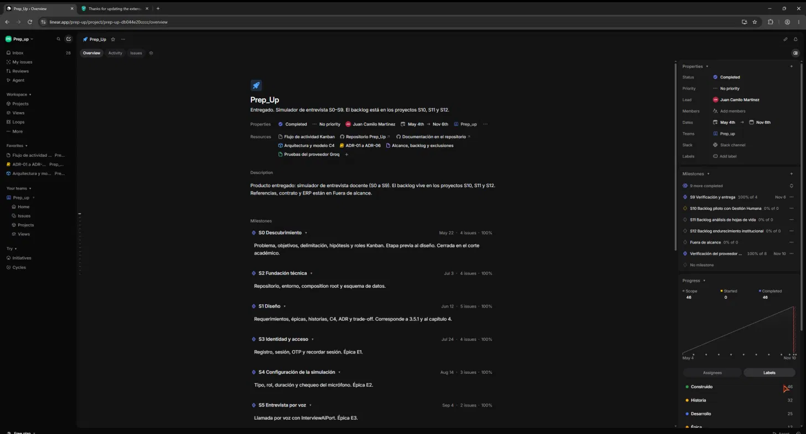
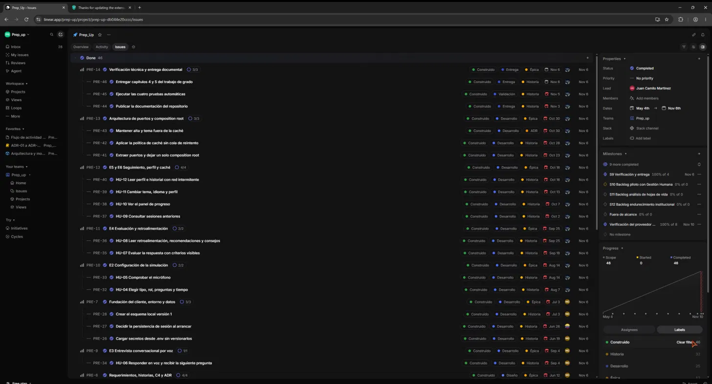
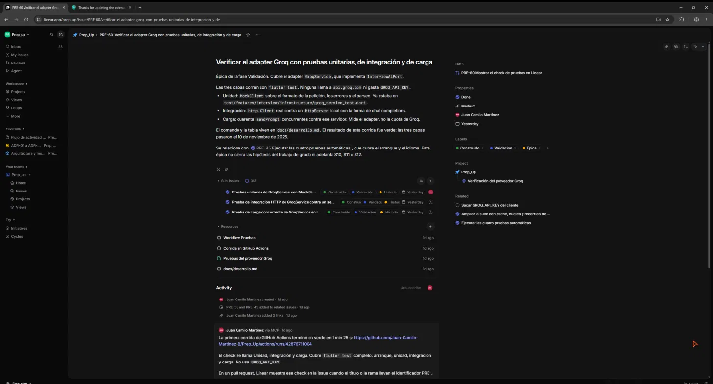
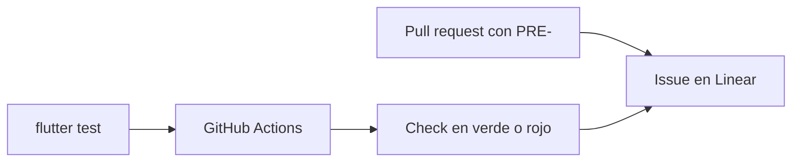
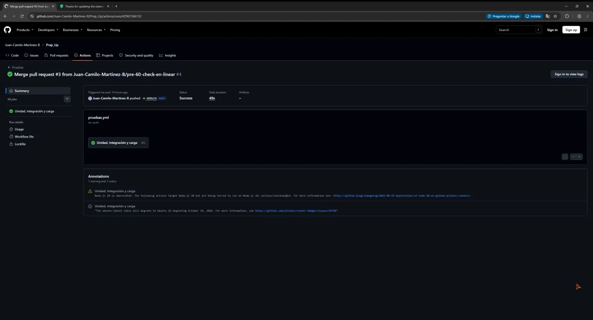

# Integración en Linear

El flujo de actividad de Prep_Up vive en el workspace [prep-up](https://linear.app/prep-up), equipo **Prep_up** (clave `PRE`). El producto entregado está en el proyecto [Prep_Up](https://linear.app/prep-up/project/prep-up-db044e20cccc). El backlog posterior al corte académico está en los proyectos S10, S11 y S12. Referencias, contrato y ERP están en Fuera de alcance.

Linear no ejecuta `flutter test`. GitHub Actions corre la suite. Linear muestra el resultado cuando un pull request lleva un identificador `PRE-` en el título o en el nombre de la rama.

## Proyecto

El proyecto está en **Completed**. El periodo visible es del 4 de mayo de 2026 al 6 de noviembre de 2026. El resumen dice: entregado, simulador de entrevista S0–S9, con el backlog en S10, S11 y S12.

En Resources están los documentos del modelo y los dos enlaces al repositorio. El hito **Verificación del proveedor Groq** aparece al 100 % con fecha 10 de noviembre de 2026.

| Hito | Fecha | Qué cubre |
| --- | --- | --- |
| S0 Descubrimiento | 22 may 2026 | Problema, objetivos, delimitación, hipótesis y roles |
| S1 Diseño | 12 jun 2026 | Requerimientos, épicas, historias, C4 y ADR |
| S2 Fundación técnica | 3 jul 2026 | Repositorio, entorno, composition root y esquema |
| S3 Identidad y acceso | 24 jul 2026 | Registro, sesión, OTP y recordar sesión |
| S4 Configuración de la simulación | 14 ago 2026 | Tipo, rol, duración y micrófono |
| S5 Entrevista por voz | 4 sep 2026 | Llamada por voz con `InterviewAiPort` |
| S6 Evaluación e informe | 25 sep 2026 | Informe, desglose y recomendaciones |
| S7 Seguimiento y experiencia | 16 oct 2026 | Historial, panel, perfil, tema, idioma y caché |
| S8 Arquitectura de puertos | 30 oct 2026 | Monolito modular y ADR-01 a ADR-06 |
| S9 Verificación y entrega | 6 nov 2026 | Pruebas automáticas y documentación del repo |
| Verificación del proveedor Groq | 10 nov 2026 | Suite del adapter y la ampliación de caché, núcleo y autenticación |

S0 a S9 y el hito de Groq están al 100 %. S10, S11, S12 y Fuera de alcance quedaron en 0 % dentro de este proyecto porque esas issues se movieron a sus propios proyectos. Este documento no adelanta esas fechas ni cierra las hipótesis del trabajo de grado.

## Cómo se clasifica una issue

Cada issue lleva una sola etiqueta de cada grupo.

| Grupo | Etiquetas | Para qué sirve |
| --- | --- | --- |
| Fase | Descubrimiento, Diseño, Desarrollo, Validación, Entrega, Backlog | Etapa del Kanban |
| Tipo | Épica, Historia, ADR, Deuda | Clase de ítem |
| Alcance | Construido, Pendiente, Fuera de alcance | Si está en la demo, pendiente o excluido |

Las vistas del equipo filtran por la etiqueta de fase. Una issue de pruebas nuevas va en Validación, con tipo Historia o Épica, y alcance Construido cuando la prueba ya pasó. No lleva una segunda etiqueta Backlog.

## Documentos del proyecto

Están en Overview, sección Resources. No aparecen en la pestaña Documents del equipo.

| Documento | Qué guarda |
| --- | --- |
| [Flujo de actividad Kanban](https://linear.app/prep-up/document/flujo-de-actividad-kanban-140a727e5902) | El flujo de fases |
| [Arquitectura y modelo C4](https://linear.app/prep-up/document/arquitectura-y-modelo-c4-68217031caf8) | Capas y puertos. El texto nombra `GroqService`. Las figuras C4 siguen diciendo Gemini |
| [ADR-01 a ADR-06](https://linear.app/prep-up/document/adr-01-a-adr-06-51275dc1c20d) | Decisiones. ADR-01 y ADR-02 nombran Groq. ADR-04 es la clave `GROQ_API_KEY` en el cliente |
| [Alcance, backlog y exclusiones](https://linear.app/prep-up/document/alcance-backlog-y-exclusiones-a1ec0168dc29) | Qué entra, qué queda en S10–S12 y qué está excluido |
| [Pruebas del proveedor Groq](https://linear.app/prep-up/document/pruebas-del-proveedor-groq-5bb15a5cbce8) | Tabla de la suite y el enlace con Actions |

También hay enlaces a [docs/](https://github.com/Juan-Camilo-Martinez-B/Prep_Up/tree/main/docs) y al [repositorio](https://github.com/Juan-Camilo-Martinez-B/Prep_Up).

## Tablero

Las issues del proyecto se agrupan por épica. Cada fila muestra el identificador, el título y las etiquetas de alcance, fase y tipo.

En la parte alta se ve la entrega y la verificación: PRE-14, PRE-45 (las cuatro pruebas automáticas, fase Validación) y PRE-13 (arquitectura de puertos). Más abajo siguen las épicas de desarrollo, de E6 a E1.

## Suite registrada en Validación

Dos épicas, las dos en Done, en el hito Verificación del proveedor Groq, con fecha 10 de noviembre de 2026.

| Issue | Qué cubre |
| --- | --- |
| [PRE-60](https://linear.app/prep-up/issue/PRE-60/verificar-el-adapter-groq-con-pruebas-unitarias-de-integracion-y-de) | Adapter `GroqService`: unidad con `MockClient`, integración HTTP contra un servidor local y carga de 40 llamadas concurrentes |
| [PRE-61](https://linear.app/prep-up/issue/PRE-61/pruebas-unitarias-de-groqservice-con-mockclient) | Unidad del adapter |
| [PRE-62](https://linear.app/prep-up/issue/PRE-62/prueba-de-integracion-http-de-groqservice-contra-un-servidor-local) | `http.Client` real contra el servidor local |
| [PRE-63](https://linear.app/prep-up/issue/PRE-63/prueba-de-carga-concurrente-de-groqservice-en-local) | Carga concurrente |
| [PRE-64](https://linear.app/prep-up/issue/PRE-64/ampliar-la-suite-con-cache-nucleo-y-recorrido-de-autenticacion) | Núcleo, caché y recorrido de autenticación |
| [PRE-65](https://linear.app/prep-up/issue/PRE-65/pruebas-unitarias-de-nucleo-rutas-y-configuracion-de-entrevista) | Configuración, errores, feedback, rutas y ocupación |
| [PRE-66](https://linear.app/prep-up/issue/PRE-66/pruebas-de-la-cache-con-bases-en-memoria) | Caché con dos bases en memoria |
| [PRE-67](https://linear.app/prep-up/issue/PRE-67/recorrido-de-autenticacion-de-extremo-a-extremo) | Portada, registro, login vacío, credenciales rechazadas y recuperación |

PRE-60 se relaciona con PRE-45 y con PRE-64. PRE-45 sigue siendo la historia de las cuatro pruebas automáticas de S9. Ninguna de estas pruebas llama a `api.groq.com`, a Supabase ni a un teléfono.

## Cómo se ve el check dentro de la issue

PRE-60 concentra el enlace con GitHub: el pull request, el workflow, una corrida, el documento de pruebas y `docs/desarrollo.md`. Abajo están las historias hijas y el comentario de la primera corrida en verde.

En la columna derecha, **Diffs** apunta al pull request [PRE-60 Mostrar el check de pruebas en Linear](https://github.com/Juan-Camilo-Martinez-B/Prep_Up/pull/3). Ese pull request ya está fusionado en `main` (`40f6d16`).

## De la prueba al tablero

El workflow es [`.github/workflows/pruebas.yml`](https://github.com/Juan-Camilo-Martinez-B/Prep_Up/blob/main/.github/workflows/pruebas.yml). Se dispara con un push a `main` y con cada pull request. El job se llama **Unidad, integración y carga** y ejecuta `flutter test`, así que entran la unidad, la integración, la carga y el recorrido de autenticación. El runner usa Flutter 3.38.9 y escribe un `.env` de ejemplo, sin clave.

La corrida del merge a `main` terminó en **Success** en 49 segundos, sobre el commit `40f6d16`.

Para que el check aparezca en la issue hace falta un pull request cuyo título o rama contenga `PRE-60`, `PRE-67` u otro identificador. Un push a `main` corre la suite y deja el resultado en el commit. No lo cuelga solo en la issue. En el cuerpo del pull request no conviene escribir "Fixes" ni "Closes": al fusionarlo, Linear puede marcar la issue como cerrada. El identificador en el título basta para enlazarla.

El recorrido de autenticación no tiene un workflow aparte. Vive en `test/e2e/auth_flow_test.dart` y entra en el mismo `flutter test`.

## Qué queda fuera

- Linear no lanza ni aloja `flutter test`.
- La suite no mide la calidad del modelo real ni gasta `GROQ_API_KEY`.
- El recorrido de autenticación usa pantallas reales y un puerto de auth falso. No sustituye una prueba en un teléfono.
- Sacar `GROQ_API_KEY` del cliente sigue en [PRE-53](https://linear.app/prep-up/issue/PRE-53), en backlog de S12.
- S10, S11 y S12 siguen en backlog. Las hipótesis del trabajo de grado siguen abiertas.
